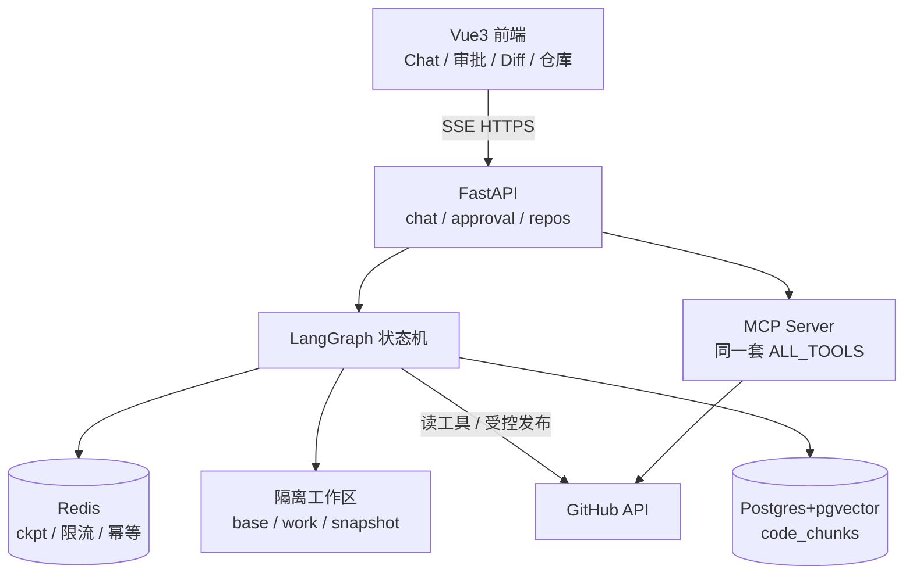

# GitHub Agent 项目答辩逐字稿

| 项目 | 说明 |
|------|------|
| **项目名称** | GitHub Agent（企业级智能研发助手） |
| **文档用途** | 毕业设计 / 实习答辩 / 项目汇报 / 技术面试口述稿 |
| **生成依据** | 以 `github-agent` 工作区真实代码、配置与测试为主；不以 README 营销表述为准 |
| **生成日期** | 2026-03-26 |
| **配套文件** | 同目录 `项目答辩逐字稿.docx` |

> **使用说明：** 正文「完整答辩逐字稿」可直接照读练习。带「【答辩提示】」的段落为备课备注，答辩时不必照念。文中「待补充确认」处请用你本人的真实情况替换。

---

## 目录

1. [项目概述](#一项目概述)
2. [项目背景与用户痛点](#二项目背景与用户痛点)
3. [项目目标与整体解决方案](#三项目目标与整体解决方案)
4. [技术栈与系统架构](#四技术栈与系统架构)
5. [核心功能讲解](#五核心功能讲解)
6. [技术难点与解决方案](#六技术难点与解决方案)
7. [项目亮点](#七项目亮点)
8. [测试与验证](#八测试与验证)
9. [项目不足与未来规划](#九项目不足与未来规划)
10. [完整答辩逐字稿](#十完整答辩逐字稿可直接照读)
11. [核心代码定位与演示建议](#十一核心代码定位与答辩演示建议)
12. [答辩常见问题与参考回答](#十二答辩常见问题与参考回答)
13. [待确认信息清单](#十三待确认信息清单)

---

## 一、项目概述

**GitHub Agent** 是一套面向软件研发场景的智能助手：用户用自然语言描述「查 Issue、读代码、改文件、提 PR」等需求，系统通过多阶段 Agent 流水线完成分析、规划、隔离区编码、人工审批与受控发布。

一句话定位：**不是自动往主干乱改代码的机器人，而是「可读可写、可中断、可审批、可审计」的 GitHub 研发 Agent。**

系统主体位于工作区目录 `github-agent/`，包含：

- **前端** `frontend/`：Vue 3 + Vite + TypeScript，对话、审批、Diff 审阅、仓库浏览等页面
- **后端** `backend/app/`：FastAPI + LangGraph 状态机、多 Agent、护栏、RAG、审批与工作区
- **微服务可选** `services/`：Gateway / Agent / Repo / MCP 分离部署
- **基础设施**：Redis（检查点、限流、幂等）、Postgres + pgvector（代码检索）、Docker Compose

---

## 二、项目背景与用户痛点

### 2.1 业务场景（有代码依据的叙述）

日常开发里，很多操作其实是「在 GitHub 上围绕仓库做一系列只读或写操作」：列出 Issue、阅读某文件、按审查意见改几处代码、开分支、提交、创建 Pull Request。这些步骤本身并不神秘，但操作路径长、上下文切换多，且**写操作一旦做错成本高**（误改主干、误改 CI/密钥文件、重复提 PR）。

### 2.2 现有方式的具体问题

| 痛点 | 具体表现 | 为何值得解决 |
|------|----------|--------------|
| 操作链条长 | 浏览器、本地 IDE、Git CLI、GitHub 网页来回切换 | 简单修改也要十几步，认知负担高 |
| 大模型直连写仓库风险高 | 若让 LLM 直接调 GitHub API 写 `main`，缺少闸门 | 一次幻觉可能导致生产事故 |
| 对话上下文易撑爆 | ReAct 多轮工具调用后 messages 膨胀 | 成本上升、协议报错、效果变差 |
| 代码问答缺仓库感知 | 只靠聊天模型「猜」代码结构 | 回答不可靠，难以落地到真实路径 |
| 审批与执行脱节 | 口头说「帮我提 PR」却无法在系统内确认 Diff | 责任边界不清 |

> **待补充确认：** 若有真实实习/课程场景（例如团队仓库协作、助教批改、个人开源维护），请替换本节为具体故事；当前不以虚构用户调研数据支撑。

### 2.3 目标用户

- 需要频繁读写 GitHub 仓库的**开发者 / 实习工程师**
- 希望演示「Agent + HITL（人在回路）」工程能力的**学生 / 求职者**
- 对「AI 改代码必须可审批」有要求的**小团队技术负责人**（定位为演示级系统，非已规模化上线产品）

---

## 三、项目目标与整体解决方案

### 3.1 核心目标

1. **自然语言驱动** GitHub 研发闭环：读 → 搜 → 改 → 审 → 发。
2. **高危写操作必须人工确认**：计划确认、Diff 确认、发布确认分层门禁。
3. **隔离编码**：Coding Agent 只改本地工作区副本，不能默认写远程。
4. **可恢复中断**：LangGraph Checkpointer + interrupt/resume，审批后从断点继续。
5. **可观测与可降级**：限流、幂等、RAG 本地回退、测试门禁硬关闭等工程化设计。

### 3.2 解决思路（场景 → 方案）

```
用户自然语言需求
    → 意图分类（规则快路径 + LLM）
    → Jev 编排决策（任务类型 / 风险 / 是否走多 Agent）
    → 写任务：分析 → 规划 →【人工确认计划】→ 工作区编码 →【确认 Diff】
      → Testing（无隔离执行器则 unavailable）→【发布审批】→ Publish（哈希校验后写 GitHub）
    → 读/问答：上下文压缩 → ReAct 选工具 → 护栏 →（必要时）审批
```

---

## 四、技术栈与系统架构

### 4.1 技术栈及在本项目中的职责

| 层级 | 技术 | 在本项目中的具体职责 |
|------|------|----------------------|
| 前端 | Vue 3、Vue Router、Pinia、Vite、TypeScript | 页面路由、状态、操作员 Token、SSE 流式展示 |
| 前端增强 | Monaco Editor、axios、fetch SSE | Diff/文件编辑体验；直连后端避免代理缓冲 SSE |
| 后端 API | FastAPI、Pydantic、uvicorn | `/api/chat/stream`、审批、仓库、Webhook、用量等 |
| Agent 编排 | LangGraph、LangChain | 状态机节点、条件边、interrupt、工具调用 |
| 存储 | Redis | Checkpointer、令牌桶限流、幂等锁、会话/轨迹 |
| 向量库 | Postgres + pgvector、BM25、可选 Cross-Encoder | 代码分块索引与混合检索精排 |
| 可观测 | Langfuse（可选）、结构化 trace_id | 节点路径与调用追踪 |
| 部署 | Docker Compose / 微服务 compose | 一键或分服务启动 |
| 安全 | OPERATOR_API_TOKEN、路径护栏、写门闩 | 操作员认证与 GitHub 写入许可 |

### 4.2 系统架构（与实现一致）



### 4.3 一次典型写任务请求链路

1. 前端 `streamSSE` → `POST /api/chat/stream`（需 `X-Operator-Token`）
2. `chat.py` 创建/复用 task run，调用 `stream_agent`
3. 图：`classify_intent` → `jev_decide` → `repo_analysis` → `planning_agent` → `await_plan_confirm`（interrupt）
4. 用户在前端确认计划 → `POST /api/approval/{tid}` → resume
5. `coding_agent` 写入 `.data/workspaces/{task_id}/work`，产出 Diff
6. `await_diff_approve` → 用户确认 Diff → `testing_agent`（当前多为 unavailable）
7. `await_publish_approve` → 用户确认发布 → `publish_agent` 在 `permit_github_write` 下推分支/提 PR
8. `finalize` 汇总；全程 SSE 推送节点时间线与任务状态

### 4.4 关键选型理由（答辩可用口述）

- **LangGraph**：需要「可暂停、可恢复」的状态机，而不是一次性脚本。
- **Vue 3 + SSE**：长任务要实时看见节点推进与审批弹窗，不能只等最终 JSON。
- **Redis 三重职责**：同一基础设施解决中断恢复、配额保护和幂等，运维心智简单。
- **隔离工作区 + 写门闩**：把「生成 Diff」与「写远程」拆开，符合安全默认拒绝原则。

---

## 五、核心功能讲解

### 功能 1：自然语言对话驱动 GitHub 读写

- **场景：** 用户选择 `owner/repo`，输入「列出最近 open issues」或「解释鉴权逻辑」。
- **输入：** 仓库名 + 自然语言；操作员 Token。
- **处理：** 意图分类 →（读路径）上下文压缩 → Agent ReAct 调用 GitHub/RAG 工具 → finalize。
- **输出：** SSE 流式 thought/action/observation 与最终回答。
- **价值：** 把分散的 GitHub 操作收敛到对话界面。
- **证据：** `backend/app/api/chat.py`、`backend/app/agent/graph.py`、`frontend/src/api/index.ts` 中 `streamSSE`。

### 功能 2：多 Agent 写任务流水线（分析 → 规划 → 编码 → 测试 → 发布）

- **场景：** 「在新分支修复文档并创建 PR」。
- **处理：** Analysis → Planning → 计划 HITL → Coding（仅工作区）→ Diff HITL → Testing → 发布 HITL → Publish。
- **输出：** 计划文档、统一 Diff、（条件满足时）远程分支与 PR。
- **价值：** 每一步可解释、可拦截；编码与发布解耦。
- **证据：** `graph.py` 中节点装配；`app/agents/coding_agent.py`、`publish_agent.py`、`testing_agent.py`。

### 功能 3：三层人工审批（HITL）

- **场景：** 计划确认、Diff 确认、发布确认。
- **处理：** `langgraph.types.interrupt` 挂起；审批记录落盘/缓存；`approval_gate` 校验 pending 未过期且任务状态匹配后才 resume。
- **输出：** 同意则继续下一节点；拒绝则走 finalize，不执行写工具副作用。
- **价值：** 责任在人，系统提供证据（计划/Diff/哈希）。
- **证据：** `nodes.py` 中 `await_*`；`services/approval_gate.py`；前端 `ApprovalModal.vue`、`PlanConfirmView.vue`、`ReviewView.vue`。

### 功能 4：代码 RAG 混合检索

- **场景：** 「这段鉴权在哪个文件？」先索引再问答。
- **处理：** 代码友好分隔符分块 → embedding 入 pgvector（或本地 JSON 降级）→ BM25 + 向量 RRF → 可选 Transformer Cross-Encoder 精排。
- **输出：** `search_codebase` 工具返回相关片段。
- **价值：** 回答锚定真实仓库内容。
- **证据：** `services/rag_service.py`、`transformer_rerank.py`、`scripts/init_db.sql` 表 `code_chunks`。

### 功能 5：六层护栏与统一写门禁

- **场景：** Agent 试图改 `.env`、写 `main`、或未审批就调 GitHub 写 API。
- **处理：** 分支/路径黑名单、规模阈值、高危 interrupt、幂等锁、SHA 乐观锁；`write_gate.require_github_write` 无 permit 直接拒绝。
- **输出：** 拦截原因或安全进入审批流。
- **价值：** 降低误写与越权发布风险。
- **证据：** `services/guardrails.py`、`services/write_gate.py`。

---

## 六、技术难点与解决方案

### 难点 1：可中断可恢复的 Agent 状态机（HITL）

1. **难点是什么：** 写操作中途必须等人审批，进程不能丢状态，也不能「盲 resume」旧检查点。
2. **为什么难：** 异步长任务、前端断开、审批过期、任务已终态等边界多；LangGraph 节点名还不能与 state 字段 `plan` 冲突。
3. **解决思路：** `compile(checkpointer=...)` + `interrupt`；审批 API 走 `approval_gate` 默认拒绝；节点名用 `planner`。
4. **具体实现：** `graph.py` 装配；`core/checkpointer.py`；`approval_gate.validate_approval_resume`。
5. **解决效果：** 同意后从断点继续；拒绝无写副作用；过期/已 resolved 不可复用。
6. **答辩价值：** 体现对 Agent 工程「状态、副作用、恢复」的理解，而不是只会调 Chat API。

### 难点 2：编码与发布解耦（隔离工作区 + 内容哈希）

1. **难点是什么：** LLM 生成的修改必须先给人看 Diff，且发布时必须是「当时批准的那份内容」。
2. **为什么难：** 若边改边写远程，无法回滚审阅；若审批后文件被篡改，存在调包风险。
3. **解决思路：** `base/` 基线 + `work/` 可写副本；批准后固化 `approved_snapshot` 与 `content_hash`；Publish 校验哈希。
4. **具体实现：** `workspace_service.py`；`coding_agent.py`；`publish_agent.py` 中哈希与 `permit_github_write`。
5. **解决效果：** 人审的是真实 unified Diff；发布字节与批准快照一致。
6. **答辩价值：** 安全工程中的「证据链」思维。

### 难点 3：上下文工程（进模前压缩，检查点保留全量）

1. **难点是什么：** 多轮工具调用后 messages 过长，直接塞模型会超窗或协议错误。
2. **为什么难：** 裁剪时必须保持 `tool_calls` 与 `ToolMessage` 配对；又要审批可恢复完整轨迹。
3. **解决思路：** Checkpointer 保留完整 messages；`compact_context` 按 token 预算 trim/摘要。
4. **具体实现：** `services/context_engine.py`、`nodes.compact_context_node`。
5. **解决效果：** 控制进模成本与稳定性，同时不影响中断恢复。
6. **答辩价值：** 展示对 LLM 应用「工作上下文」与「审计轨迹」分层的理解。

### 难点 4：发布测试门禁的诚实设计（无隔离执行器则硬关闭）

1. **难点是什么：** 没有可信沙箱时，不能假装「测试已通过」去授权真实 GitHub 写。
2. **为什么难：** LLM 或状态字段可伪造 `passed=True`；宿主机直接跑仓库命令不安全。
3. **解决思路：** Testing Agent 强制 `unavailable/not_run`；`evaluate_test_gate` 对伪造 passed 一律拒绝；仅本地显式开关可做不信任旁路。
4. **具体实现：** `testing_agent.py`、`publish_agent.evaluate_test_gate`、`sandbox_service`。
5. **解决效果：** 安全默认正确；答辩时可坦诚说明限制，反而体现工程成熟度。
6. **答辩价值：** 「不会的功能不强行包装成已完成」。

### 难点 5：混合检索与可选精排 / Redis 配额保护

1. **难点是什么：** 纯向量对标识符弱；GitHub API 有小时配额；高并发限流易超发。
2. **为什么难：** 分数尺度不同；`INCR+EXPIRE` 非原子。
3. **解决思路：** BM25+向量 RRF，可选 Cross-Encoder；Redis Lua 令牌桶。
4. **具体实现：** `rag_service.py`、`transformer_rerank.py`、`core/rate_limit.py`。
5. **解决效果：** 本地可降级演示；线上更贴近配额安全。
6. **答辩价值：** 检索与基础设施层面的工程细节。

---

## 七、项目亮点

### 亮点 1：三门 HITL + 写门闩（工程特色，非「用了 LangGraph」本身）

- **是什么：** 计划 / Diff / 发布分层确认，且无 `WritePermit` 不能调 GitHub 写方法。
- **实现：** `await_*` 节点、`write_gate.py`、`publish_agent.py`。
- **对比普通实现：** 很多 Demo 是「模型一说就 commit」；本项目默认拒绝写入。
- **口述：** 「我们把生成修改和真正推远程拆开，中间必须过人审。」

### 亮点 2：隔离工作区真实 Diff

- **是什么：** Coding 只改本地副本，前端可审统一 Diff。
- **实现：** `workspace_service.py`、`ReviewView.vue`、`DiffViewer.vue`。
- **价值：** 审的是变更证据，不是模型一句「我改好了」。

### 亮点 3：上下文压缩与检查点分离

- **是什么：** 进模压缩、落盘全量。
- **实现：** `context_engine.py`。
- **价值：** 成本与可恢复性兼顾。

### 亮点 4：六层护栏 + 路径穿越防护细节

- **是什么：** 分支/敏感路径/规模/审批/幂等/乐观锁；路径规范化刻意避开 `lstrip("./")` 踩坑。
- **实现：** `guardrails.py` 注释与单测 `test_guardrails.py`。
- **口述：** 「护栏在工具之后、副作用之前，避免只靠提示词防越权。」

### 亮点 5：可降级与可观测的工程闭环

- **是什么：** RedisSaver→MemorySaver、pgvector→本地 JSON、无 Embedding→伪向量、微服务熔断与内部 Token、LLM 用量表。
- **实现：** checkpointer、rag_service、`docker-compose.micro.yml`、`llm_call_records`。
- **价值：** 演示环境与严苛环境都能讲清边界。

> **注意：** 使用 Vue/FastAPI/LangGraph 属于技术选型，**不单独称为技术创新**；亮点应落在「门禁拆分、状态机 HITL、工作区证据链」等设计上。

---

## 八、测试与验证

### 8.1 已有自动化测试（代码证据）

`backend/tests/` 覆盖面较广，例如：

| 测试文件 | 验证重点 |
|----------|----------|
| `test_intent.py` / `test_jev.py` / `test_edges.py` | 意图、编排、路由 |
| `test_guardrails.py` / `test_security_phase1.py` / `test_security_phase3.py` | 护栏与安全策略 |
| `test_checkpoint_hitl.py` / `test_hitl_routing.py` / `test_approval_gate.py` | 审批与中断恢复 |
| `test_context_engine.py` | 上下文裁剪配对 |
| `test_coding_agent.py` / `test_publish_agent.py` / `test_testing_agent.py` / `test_workspace_service.py` | 多 Agent 与工作区 |
| `test_transformer_rerank.py` / `test_mcp_server.py` / `test_gateway_routing.py` | 精排、MCP、网关 |
| `test_eval.py` / `test_llm_usage_*.py` | 评测与用量 |

> **待补充确认：** 请在答辩前本地执行 `cd backend && pytest`，记录实际通过数量；本文不编造通过率。

### 8.2 手工验收路径（README 与代码一致的可操作路径）

1. 配置 `.env`（`LLM_API_KEY`、`GITHUB_TOKEN`、`OPERATOR_API_TOKEN` 等）
2. 启动后端与前端，登录填入操作员 Token
3. 只读任务：列出 Issues / 读文件
4. 写任务：计划确认 → Diff 确认 → 发布确认（注意测试门禁与 Token 权限）
5. 重复指令观察幂等行为（若已实现对应锁）

### 8.3 当前诚实边界

- Testing Agent **没有**可信隔离执行器时不会「假装通过」。
- 操作员认证是**共享 Token**，不是完整多用户 IAM。
- 是否已在真实团队长期使用：**待补充确认**（代码未证明已上线生产）。

---

## 九、项目不足与未来规划

### 不足（已实现代码能支撑的客观限制）

1. 测试执行器未落地，发布在严格模式下受测试门禁约束。
2. 认证模型偏演示（共享 Operator Token；前端 localStorage 有 XSS 风险说明）。
3. GraphRAG 等能力偏「可视/可选」，不宜夸大为完整知识图谱产品。
4. 微服务模式增加运维复杂度，日常可用单体 compose。

### 未来规划（未实现，勿说成已完成）

1. 引入可信沙箱执行器，使 Testing 出具可验证证明后再放行 Publish。
2. 同源会话 + httpOnly Cookie + CSRF，替代浏览器存 Token。
3. 更细粒度的 per-user / per-repo ACL 与审计看板。
4. 扩大评测集与回归，把关键写路径做成 CI 门禁。

---

## 十、完整答辩逐字稿（可直接照读）

【建议时长：8～12 分钟。标「可删」段落可按时间压缩。】

### 第一部分：开场与项目介绍

各位老师 / 各位评委大家好。我汇报的项目名称是 **GitHub Agent**，中文可以叫「企业级智能研发助手」。

这个项目要解决的问题很具体：我们能不能用自然语言，在 GitHub 上完成「读 Issue、搜代码、改文件、建分支、提交、提 Pull Request」这一整条研发链路，同时又保证**高风险写操作必须经过人的确认**，而不是让大模型直接改主干。

一句话概括：它是一个带人工审批、带隔离工作区、可中断可恢复的 GitHub 研发 Agent，而不是一个只会聊天的网页。

### 第二部分：项目背景与用户痛点

在实际开发里，很多修改其实不大，但操作链条很长。开发者往往要在 IDE、终端、GitHub 网页之间来回切换：先找 Issue，再定位文件，再改代码，再开分支，再提 PR。更麻烦的是，如果直接把大模型接到 GitHub 写接口上，模型一旦幻觉，就可能改错分支、改到 `.env` 或工作流文件，甚至重复创建 PR。

所以这个项目的出发点不是「让 AI 看起来很聪明」，而是：**在自动化提效的同时，把副作用关进可审批、可审计的流程里。**

【答辩提示】若有个人真实故事（课程大作业仓库、实习仓库），在此插入 20 秒。

### 第三部分：项目目标与整体解决方案

我们设定了几条硬目标。第一，自然语言要能驱动真实的 GitHub 读写。第二，写任务必须拆成多阶段：先分析、再规划、再编码、再测试门禁、最后发布。第三，编码只能发生在本地隔离工作区，远程写入必须拿到统一的写许可。第四，审批过程中系统可以挂起，人点同意后再从检查点恢复。

整体上，用户从前端发起对话，后端用 LangGraph 跑状态机，中间用 Redis 保存检查点，用护栏拦截危险操作，用工作区生成 Diff，最后在人确认后由 Publish Agent 受控调用 GitHub API。

### 第四部分：系统架构与技术选型

前端使用 Vue 3 和 TypeScript，通过 SSE 实时展示 Agent 节点推进，并提供计划确认、Diff 审阅和发布审批界面。后端是 FastAPI，核心编排是 LangGraph。Redis 同时承担检查点、限流和幂等；Postgres 加 pgvector 做代码检索；可选接入 Langfuse 做链路追踪。

为什么选 LangGraph？因为我们需要的不是一次性脚本，而是一张带条件边、能 interrupt、能 resume 的状态机。节点只返回状态增量，消息列表用 reducer 合并，避免并行覆盖。另外有一个实现细节：规划节点不能叫 `plan`，因为会和状态字段冲突，所以代码里叫 `planner`——这也能说明我们是按框架约束认真建模的。

一次写任务的主路径是：意图分类，到 Jev 编排决策，再进入仓库分析、规划、等待计划确认、工作区编码、等待 Diff 确认、Testing、等待发布审批、Publish，最后汇总。读任务则更多走上下文压缩和 ReAct 工具循环，并在工具后过护栏。

【建议展示页面】首页选仓库 → 对话页节点时间线 → 计划确认页 → Diff 审阅页。

### 第五部分：核心功能与业务流程

我重点讲三条主线。

**第一条是对话驱动。** 用户输入自然语言后，`/api/chat/stream` 以 SSE 推送事件。前端不用干等最终结果，可以看见分类、规划、工具调用等阶段。敏感接口需要操作员 Token，服务端未配置 Token 时默认失败关闭，避免「演示环境意外裸奔」。

**第二条是多 Agent 写流水线。** Analysis Agent 只读分析；Planning Agent 产出结构化计划，包括打算改哪些文件；Coding Agent 根据计划在 `base/work` 工作区写完整文件内容并生成 unified Diff，它被明确禁止直接调 GitHub 写接口；Testing Agent 在没有可信隔离执行器时会诚实返回 unavailable，而不是用模型口头说「测试通过」；Publish Agent 只有在计划、Diff、发布都批准，并且内容哈希匹配、测试门禁允许时，才会拿到写许可去建分支和提 PR。

**第三条是代码问答。** 我们可以先给仓库文件建索引，检索时用 BM25 和向量做 RRF 融合，有条件再上 Cross-Encoder 精排。这样回答能落到真实代码片段，而不是凭空编造路径。

### 第六部分：技术难点与解决方案

最难的第一点是 **HITL 中断恢复**。高危步骤调用 interrupt 后，状态进入 Checkpointer。人审批时，我们不是简单「继续跑图」，而是先过审批门禁：没有 pending、已过期、已拒绝、任务状态不匹配，一律拒绝 resume。这样可以避免用旧检查点绕过当前业务状态。

第二点是 **隔离工作区与发布哈希**。人批准的是某一版 Diff 对应的快照。发布时校验 `content_hash`，并用上下文变量形式的 `WritePermit` 临时打开 GitHub 写能力，用完即收回。编辑器、普通工具默认没有这个许可。

第三点是 **上下文工程**。检查点里保留完整消息便于恢复和审计；真正进大模型前，由 compact 节点按 token 预算裁剪或摘要，并保持工具调用与工具结果配对，避免协议层报错。

第四点是 **测试门禁的诚实性**。我们明确知道宿主机直接执行仓库命令不安全，所以当前阶段 Testing 不强行跑命令。即便有人把状态写成 passed，Publish 侧也会因为「没有安全执行器证明」而拒绝。本地调试可以显式打开不信任旁路，但这是配置开关，不是默认行为。

第五点是 **护栏与配额**。六层护栏覆盖危险分支、敏感路径、变更规模、强制审批、幂等和冲突重试；对 GitHub 调用用 Redis Lua 令牌桶，避免高并发下超发配额。

### 第七部分：项目亮点与实际价值

如果只用一句话讲亮点，我会说：**我们把「AI 生成修改」和「AI 拥有写权限」切开了。**

用户价值是操作路径更短，但仍能看清计划与 Diff 再决定是否发布。技术价值是状态机、门禁、工作区、检索、限流形成闭环。工程价值是大量边界有单测和失败关闭策略，并且对未完成能力不强行伪装。

### 第八部分：测试与验证

后端 `tests` 目录覆盖了意图路由、护栏、审批门禁、上下文引擎、工作区、发布错误格式、安全阶段策略、网关路由、MCP 等。答辩前我会用 pytest 跑通关键用例，并用一条端到端只读任务和一条受控写任务做人工演示。关于性能提升百分比或线上用户数，我目前没有可公开的统计，所以不在这里陈述。

### 第九部分：不足与展望

当前最大的不足是缺少可信测试执行沙箱，因此严格模式下发布会受测试门禁限制。认证仍是共享操作员 Token，适合本地演示，不适合公网多租户。后续如果继续做，我会优先补沙箱证明链和会话型登录，再扩展评测回归。

### 第十部分：总结与致谢

总结一下：GitHub Agent 面向「用自然语言完成 GitHub 研发操作」这一场景，用 LangGraph 状态机、多层人工审批、隔离工作区和统一写门禁，把自动化控制在可审查的边界内。我的工作重点在……（**待补充确认：个人分工**）。

以上是我的汇报，感谢各位老师聆听，请各位批评指正。

---

## 十一、核心代码定位与答辩演示建议

### 11.1 最值得展示的代码（建议顺序）

| 顺序 | 位置 | 要讲清的重点 |
|------|------|----------------|
| 1 | `backend/app/agent/graph.py` → `build_graph` | 节点与边如何表达写流水线；`planner` 命名原因 |
| 2 | `backend/app/agent/state.py` → `AgentState` | reducer、`plan_confirmed` / Diff / publish 字段 |
| 3 | `backend/app/agent/nodes.py` → `await_plan_confirm_node` 等 | interrupt 挂起与 approval_kind |
| 4 | `backend/app/services/workspace_service.py` | base/work 隔离与 Diff |
| 5 | `backend/app/agents/coding_agent.py` | 只写工作区、输出完整文件 JSON |
| 6 | `backend/app/services/write_gate.py` | 无 permit 拒绝写远程 |
| 7 | `backend/app/agents/publish_agent.py` → `evaluate_test_gate` | 伪造 passed 也被拒 |
| 8 | `backend/app/services/guardrails.py` | 六层护栏与路径安全 |
| 9 | `backend/app/services/context_engine.py` | 压缩与配对 |
| 10 | `backend/app/services/approval_gate.py` | resume 默认拒绝 |
| 11 | `frontend/src/api/index.ts` → `streamSSE` | 为何直连、如何带 Token |
| 12 | `backend/scripts/init_db.sql` | `code_chunks` / `llm_call_records` |

### 11.2 建议演示页面顺序

1. **LoginView**：操作员 Token（说明不是完整 IAM）
2. **ChatView**：发只读指令，看 SSE 节点时间线
3. **PlanConfirmView / ApprovalModal**：计划确认
4. **ReviewView + DiffViewer**：确认 Diff
5. **UsageView / EvalView**（可选）：用量或评测入口
6. （条件允许）发布后到 GitHub 看分支/PR

### 11.3 答辩强调重点（备课用）

- 强调「副作用门禁」，不要只背框架名单。
- 主动承认 Testing 沙箱未完成，展示 `evaluate_test_gate` 更加分。
- 准备一个「如果继续做」的清晰下一步：可信执行器。

---

## 十二、答辩常见问题与参考回答

**Q1：为什么要做这个项目？**  
A：因为 GitHub 研发操作链条长，且直接让模型写仓库风险高。项目目标是用自然语言缩短操作路径，同时用 HITL 和工作区把写风险管住。具体业务故事请以我的真实场景补充（待补充确认）。

**Q2：解决了用户什么实际问题？**  
A：用户原来要手动完成找文件、改代码、开分支、提 PR；现在可以在对话里发起，系统给出计划与 Diff，人确认后再发布。减少的是切换成本与「看不见变更就写入」的风险，而不是宣称替代工程师。

**Q3：为什么选这些技术栈？**  
A：Vue3+SSE 适合长任务可视化；FastAPI 适合异步 API；LangGraph 提供检查点与 interrupt；Redis 覆盖恢复/限流/幂等；pgvector 支撑代码检索。选型服务于「可中断写流程」，不是为了堆名词。

**Q4：系统整体架构如何设计？**  
A：前端 BFF 调 FastAPI；核心是 LangGraph 状态机；写路径走多 Agent + 工作区；读路径走工具与 RAG；Redis/Postgres 分别承担状态与检索。可选 Gateway 微服务拆分，业务代码仍主要在 `backend/app`。

**Q5：最困难的问题是什么？**  
A：我认为是「可恢复的人工审批」叠加「发布内容防调包」。既要 interrupt/resume，又要 approval_gate 防盲恢复，还要用 content_hash + write_gate 保证发布字节与批准一致。

**Q6：最有价值的亮点是什么？**  
A：编码与发布解耦，以及三门审批。普通 Demo 容易「一键乱写」；我们默认无写许可。

**Q7：写任务具体如何实现？**  
A：分类与 Jev 决定走多 Agent；分析与规划后 interrupt 等计划确认；Coding 拉文件到 base、改 work、出 Diff；再 Diff 审批；Testing 当前常 unavailable；发布审批后 Publish 校验门禁与哈希，permit 内调 GitHub。

**Q8：数据库为什么这样设计？**  
A：`code_chunks` 按 repo/path/chunk 唯一，embedding 用 ivfflat 余弦索引，服务代码 RAG。`llm_call_records` 记录每次模型调用的 token、时延、模块，便于用量分析。会话/审批大量在 Redis 与本地 `.data`，不是所有状态都进 Postgres。

**Q9：如何处理异常、权限、安全或一致性？**  
A：操作员 Token 失败关闭；Webhook 无 secret 默认拒绝；路径护栏防穿越与敏感文件；写门闩防未授权 GitHub 写；幂等键防重复副作用；审批过期与已 resolved 拒绝 resume。共享 Token 的局限我会主动说明。

**Q10：如何验证功能正确？**  
A：以 `backend/tests` 单测为主，覆盖护栏、HITL、发布门禁等；再加手工 SSE 验收。具体 pytest 数量待我答辩前跑一遍补充。

**Q11：还有哪些不足？**  
A：缺可信测试沙箱；认证非多用户；公网不适合用 localStorage Token；部分能力依赖可选组件（精排模型、Langfuse）。

**Q12：下一步做什么？**  
A：优先做隔离执行器与测试证明，打通严格模式下的安全发布；其次做会话登录与更细 ACL。

**Q13：与常规实现相比值得关注什么？**  
A：不是「会不会调 GitHub API」，而是状态机门禁、工作区证据链、对未完成测试能力的硬关闭。

**Q14：用户量或数据量增大如何优化？**  
A：GitHub 侧已有令牌桶思路；Agent 与 Repo 可按微服务拆分并加熔断；RAG 索引按仓库增量更新；Checkpointer 与任务存储需评估耐久与水平扩展。这些是方向，当前没有大规模压测数据（待补充确认）。

**Q15：哪些工作是本人完成的？**  
A：**待补充确认。** 请按真实分工填写，例如：状态机与 HITL、工作区与 Publish 门禁、前端审批页、护栏单测、微服务网关等。切勿把未参与模块说成独立完成。

---

## 十三、待确认信息清单

请在答辩前补全并替换文中标记：

1. 个人真实姓名、学校/公司、答辩身份（毕设 / 实习 / 面试）
2. 项目起止时间与个人分工比例
3. 是否有真实仓库演示账号（注意脱敏 Token）
4. `pytest` 最新运行结果（通过/失败数）
5. 是否做过真实用户试用或仅本地自测
6. 是否使用过微服务模式与 MCP 对接 Cursor 的实操经历
7. 开场是否需要英文项目名解释或课程背景一句话
8. 与 `hello-agents` 教程仓库的关系（本答辩稿以 `github-agent` 实现为准；若课程要求绑定教程章节，请自行加一句说明）

---

*文档结束。请以代码与可演示行为为准，勿夸大未实现能力。*
